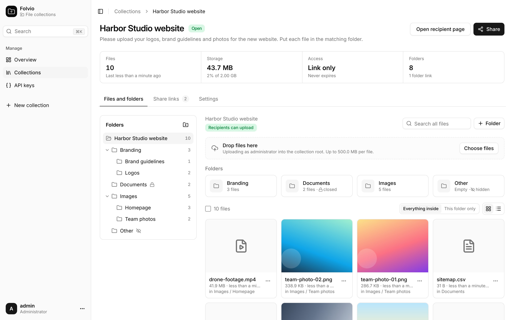
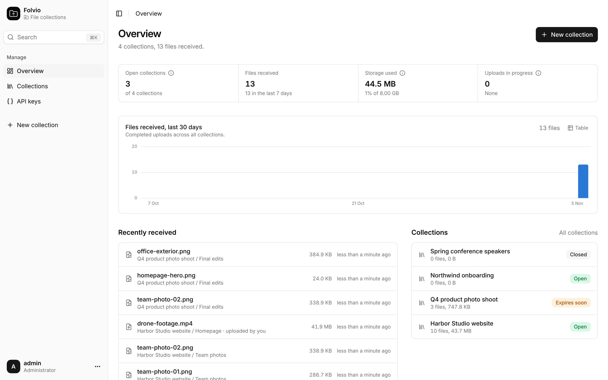
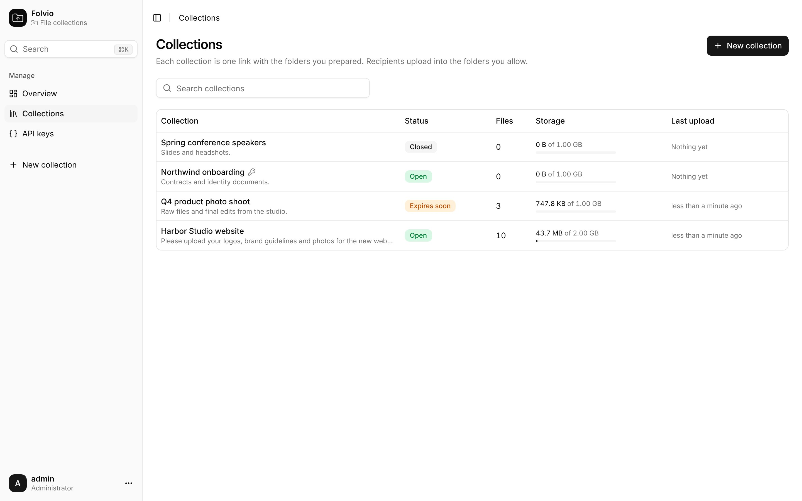
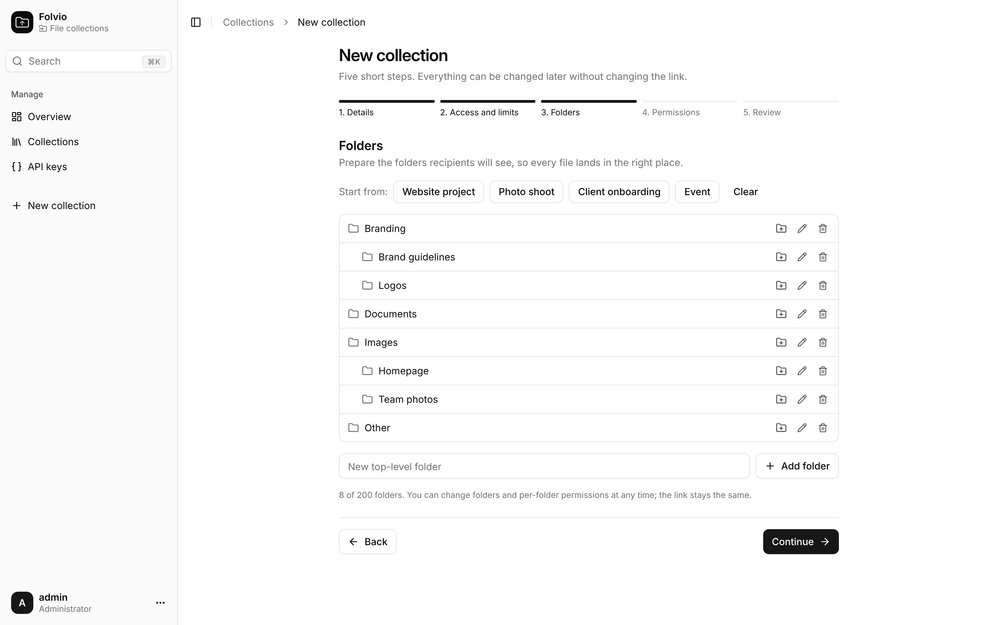
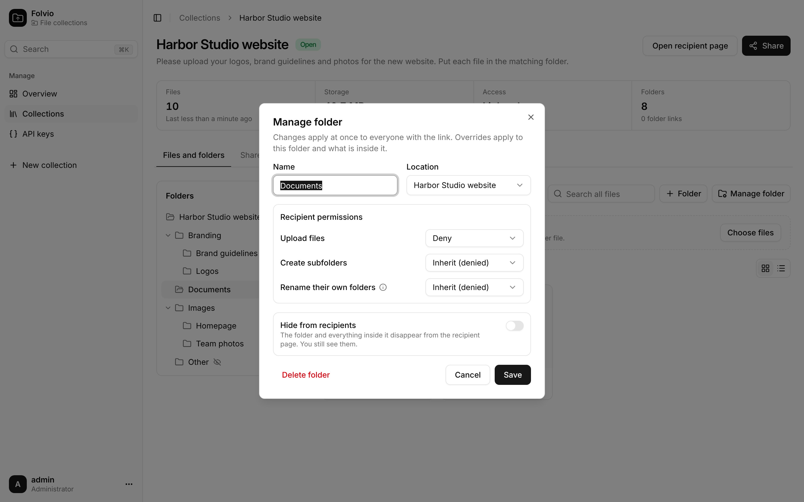
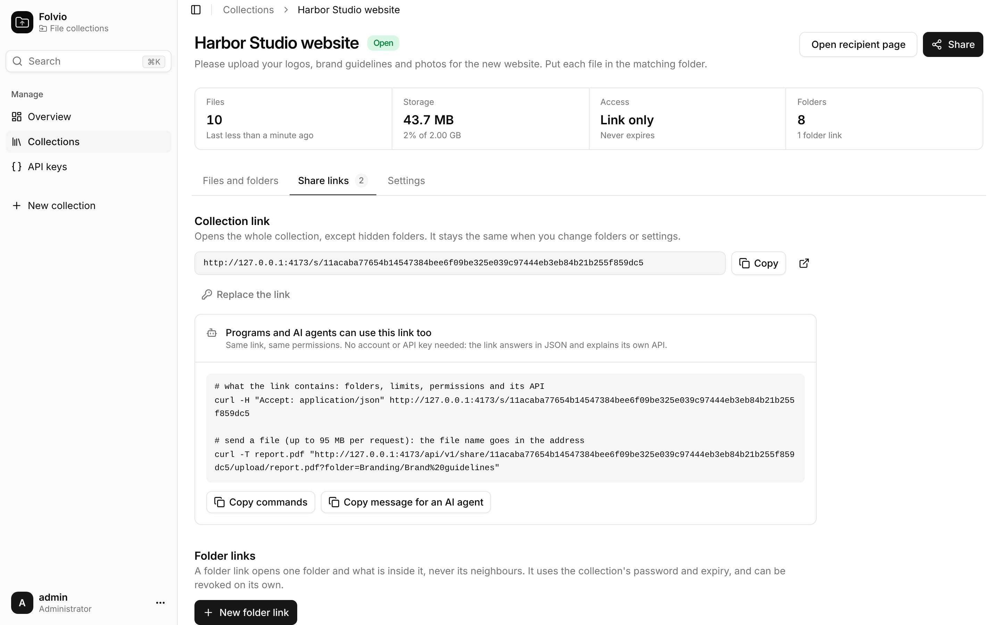
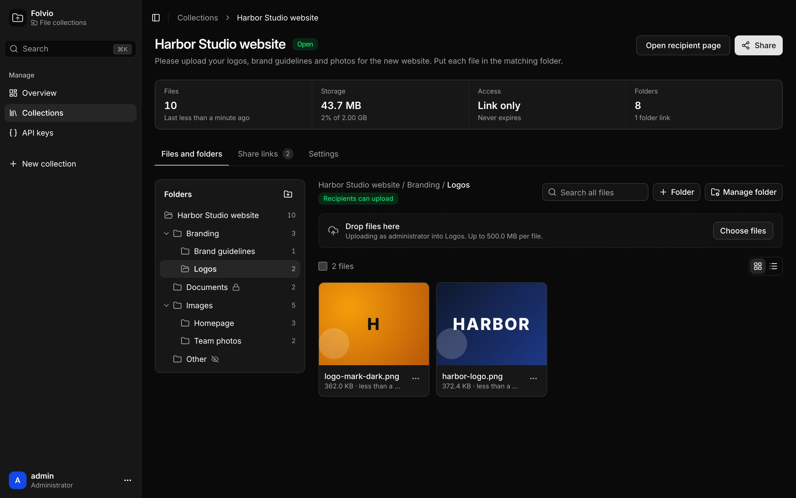
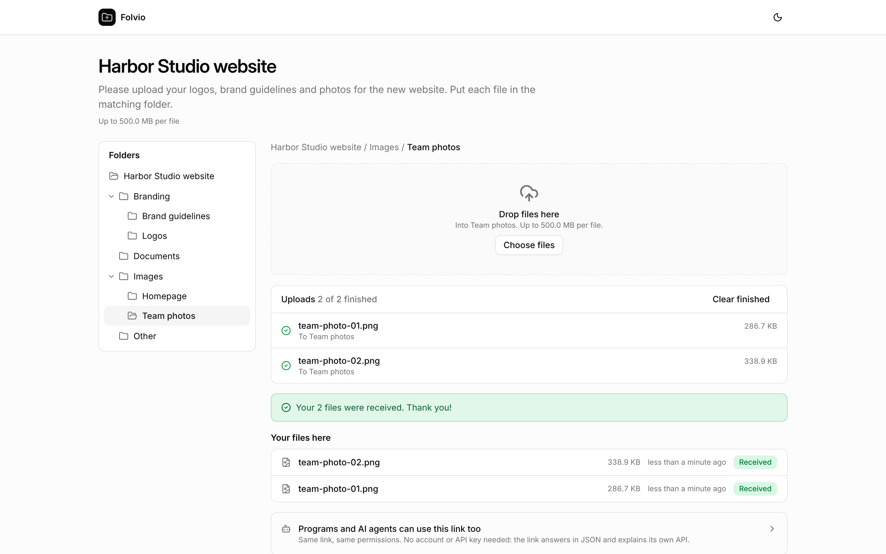
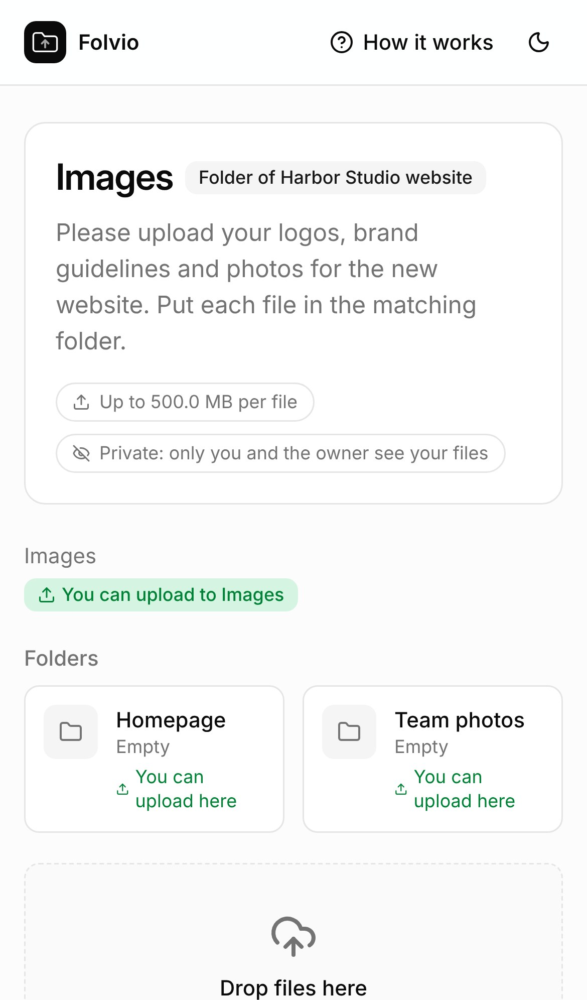
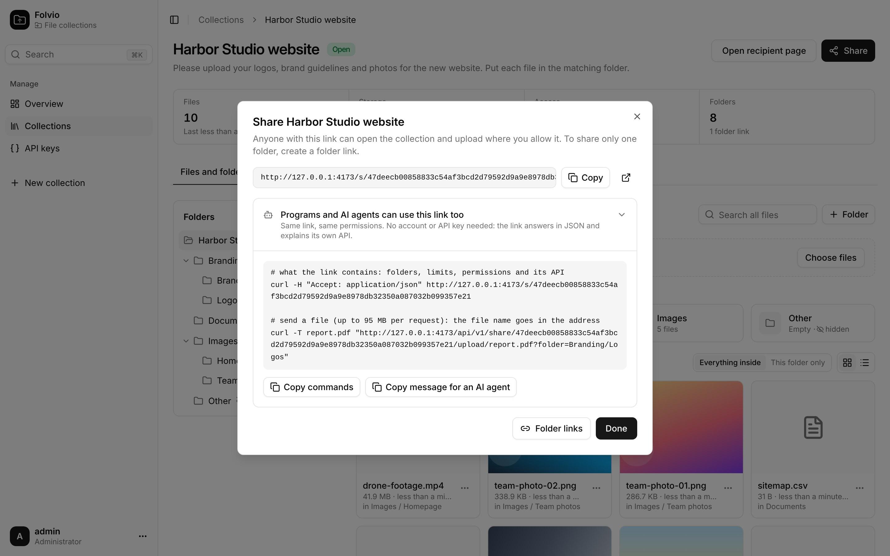

<p align="center"></p>

<h1 align="center">Folvio</h1>

<p align="center">
Self-hosted file collections on Cloudflare Workers, D1 and R2.<br>
Prepare the folders. Share one link. Receive every file in the right place.<br>
People upload from the browser; programs and AI agents use the same link.
</p>

<p align="center">
<a href="https://deploy.workers.cloudflare.com/?url=https://github.com/momardia54/folvio"></a>
</p>

<p align="center">
<a href="#quick-start">Quick start</a> · <a href="#links-for-programs-and-ai-agents">Links for programs and AI agents</a> · <a href="API.md">API</a> · <a href="ARCHITECTURE.md">Architecture and costs</a> · <a href="CHANGELOG.md">Changelog</a> · <a href="SECURITY.md">Security</a>
</p>

> **Status: pre-1.0, version 0.2.0 (unreleased).** 0.2.0 is a full rebuild on the same stack as [Warden](https://github.com/momardia54/Warden): React Router 7 on Workers, shadcn/ui, automatic D1/R2 provisioning and in-Worker migrations. The data model of 0.1.0 is kept. The API and data model may still change before 1.0; see [CHANGELOG.md](CHANGELOG.md) and [ACCEPTANCE.md](ACCEPTANCE.md).



## Why Folvio

Collecting project files should not mean sorting e-mail attachments and shared-drive links. Folvio gives each project one link with the folder structure already prepared, and you decide where recipients may upload. One administrator runs the installation; recipients need no account. They open the link, enter a password if you set one, and drop files into the folders you allow.

```text
Harbor Studio website/            one link: https://files.example.com/s/3f9c…
├── Branding/
│   ├── Brand guidelines/
│   └── Logos/                    ← its own link, if you want: only this folder
├── Documents/                    uploads closed, subfolders allowed
├── Images/
│   ├── Homepage/
│   └── Team photos/
└── Other/                        hidden from recipients
```

## Quick start

1. **Deploy** with the button above, or `npm run deploy` (see [Deploy](#deploy)). The Worker, its D1 database, its R2 bucket and the hourly clean-up are created for you; the tables are created on the first request.
2. **Add the admin secrets** `ADMIN_USERNAME`, `ADMIN_PASSWORD` and `SESSION_SECRET`. Until they exist, the login page shows exactly what to add and where.
3. **Create a collection** in five short steps: details, access and limits, folders (start from an example tree or build your own), permissions, review.
4. **Share the link.** Received files appear in the matching folders, with previews, search and bulk actions.

## Features

**Collections and folders**
- A five-step wizard with folder templates (website project, photo shoot, client onboarding, event) and an editable nested tree.
- Stable, random links. Optional password, expiry date, storage limit and maximum file size per collection. Replace the link at any time if it reached the wrong people.
- Per-folder overrides for upload, subfolder creation and renaming (allow, deny or inherit), and hidden folders whose whole subtree disappears for recipients.
- **Folder links**: a link that opens one folder and what is inside it, never its neighbours, revocable on its own.
- Recipient folder creation is **off by default**, so files land in the structure you prepared. Recipients can never move or delete folders.

**Received files**
- Grid view with image previews, or list view; search across the whole collection; select, move, rename, delete and download.
- Per-folder file counts, storage use per collection and for the installation, last-upload times.
- An overview with open collections, files received, storage against the limit, uploads in progress and a 30-day chart.

**Uploads**
- Drag and drop, a queue with progress per file and cancel. Files are streamed through the Worker straight into R2 in 16 MiB parts: no S3 keys, no bucket CORS, no buffering in JavaScript.
- Atomic quota reservations: uploads in progress count, so a collection can never be overfilled. Abandoned uploads are aborted every hour and their space released.

**Dashboard**
- The Warden dashboard: collapsible sidebar, ⌘K search for collections and files, light and dark themes, phone-friendly layout.
- Revocable API keys for automating collections, folders, links and files.

| Overview | Collections |
| --- | --- |
|  |  |

| New collection | Folder permissions |
| --- | --- |
|  |  |

| Share links | Dark theme |
| --- | --- |
|  |  |

## What recipients see

A clean page with your instructions, the folders they may use, a drop area and the files *they* sent. They never see other recipients' files or hidden folders.

<p>


</p>

## Links for programs and AI agents

Every share link is also an API. A script, an integration or an AI agent that is handed the link can discover what it contains and upload into it, with exactly the permissions a person would have. No account or API key is needed: the link is the credential.

```bash
# 1. Ask the link what it is: name, instructions, folders (with paths), limits, permissions and how to upload.
curl -H "Accept: application/json" https://files.example.com/s/<token>

# 2. Send a file in one request (up to 95 MB), into a folder named by its path.
curl -T logo.svg "https://files.example.com/api/v1/share/<token>/upload/logo.svg?folder=Branding/Logos"
```

- The first response carries an `X-Folvio-Recipient` header. Send it back on later requests to list the files that program sent (`GET …/files?folder=Branding/Logos`). Each program only sees its own uploads, like each browser.
- Password-protected links: send `X-Folvio-Password: <password>` on the first request (attempts are throttled).
- Folders can be given by path (`Branding/Logos`, case-insensitive) or by id. A folder link's paths start at its folder.
- Larger files use the same parts protocol as the browser (reserve, PUT parts, complete). The JSON manifest spells it out.
- The page of a link also advertises its API (`Link: </api/v1/share/<token>>; rel="alternate"; type="application/json"`), so an agent that fetched the HTML finds it too.

The Share dialog has **Copy message for an AI agent**: a ready-made instruction with the link that you can paste into an assistant or hand to a colleague's script.



## Deploy

### Deploy button

Click the button at the top. Cloudflare copies the repository to your GitHub account, builds it and deploys it; the D1 database and the R2 bucket are created automatically, named after the Worker. Then add the runtime secrets (below). R2 must be activated once in the Cloudflare dashboard (it asks for a payment method, even for the free allowance); until it is, the dashboard says so.

### Command line

Requirements: Node 22 and a Cloudflare account with R2 activated.

```bash
npm install
npx wrangler login
npm run deploy       # builds, creates the D1 database "<worker-name>-db", the R2 bucket and the hourly Cron Trigger, deploys
npx wrangler secret put ADMIN_USERNAME
npx wrangler secret put ADMIN_PASSWORD
npx wrangler secret put SESSION_SECRET     # recommended: openssl rand -hex 32
```

Nothing to fill into `wrangler.jsonc`: it has no `database_id` and no `bucket_name` on purpose. On deploy Wrangler creates `<worker-name>-db` and a bucket for the Worker and keeps reusing them, so two installs on one account never share data. The Worker applies its own migrations on the first request, so there is no migration step either (`npm run migrate:remote` remains available as a fallback). Set the optional `DB_SUFFIX` build variable to name the database `<worker-name>-<suffix>` instead.

**Connected repository (Workers & Pages → Create → Import a repository).** Nothing to enter: keep the commands Cloudflare suggests, even an empty build command. In Workers Builds (`WORKERS_CI=1`) Folvio builds itself right after the dependency install, so the default deploy command `npx wrangler deploy` finds the build. Node 22 is pinned in `.node-version`; the database and the bucket are created on the first deploy.

Use a custom domain (Workers → your Worker → Settings → Domains) so shared links do not depend on `workers.dev`.

> **Set `SESSION_SECRET` before you share links.** It signs cookies and hashes collection passwords. Changing it later signs recipients out and makes existing collection passwords stop matching (set them again).

### Configuration

| Name | Kind | Purpose |
| --- | --- | --- |
| `ADMIN_USERNAME` | Secret | Dashboard username |
| `ADMIN_PASSWORD` | Secret | Dashboard password, 12+ random characters |
| `SESSION_SECRET` | Secret | Recommended. 32+ random characters for cookies and collection passwords |
| `STORAGE_LIMIT_BYTES` | Variable | Installation-wide storage limit, default 8,000,000,000 bytes |

| Binding | Resource | Created by |
| --- | --- | --- |
| `DB` | D1 | Wrangler, on deploy (`<worker-name>-db`) |
| `FILES` | R2 Standard, private | Wrangler, on deploy |

Add secrets under Worker **Settings → Variables and Secrets** (type *Secret*), not under the build settings. There is no default login and no public registration.

Recommended R2 safety net: a lifecycle rule that aborts incomplete multipart uploads after one day (`npx wrangler r2 bucket lifecycle add <bucket> folvio-abort-incomplete "" --abort-multipart-days 1`). Folvio's hourly clean-up does this already; the rule covers the unexpected.

## The admin API

Create a key on **API keys**. It is shown once and has full administrator access: keep it on your server.

```bash
curl -X POST https://files.example.com/api/v1/collections \
  -H "Authorization: Bearer $FOLVIO_KEY" -H "Content-Type: application/json" \
  -d '{"name":"Harbor Studio","password":"","folders":[{"id":"1","name":"Branding"},{"id":"2","name":"Logos","parent":"1"}]}'
# -> {"id":"…","token":"…","url":"https://files.example.com/s/…"}
```

Collections, folders and permissions, folder links, file listing, rename, move, delete and download are covered in [API.md](API.md).

## Run locally

```bash
npm install
printf 'ADMIN_USERNAME="admin"\nADMIN_PASSWORD="a-long-password"\nSESSION_SECRET="%s"\n' "$(openssl rand -hex 32)" > .dev.vars
npm run dev          # http://localhost:5173, with local D1 and R2
npm test             # server logic and API on a real SQLite database and an R2 stand-in
npm run typecheck
```

## Free-tier operation

Folvio runs on Workers Free, D1 and R2 Standard: no paid Workers plan, Queues or Durable Objects. File contents stream through the Worker into R2 one bounded part at a time. R2 has a free monthly allowance (10 GB-month, 1M Class A and 10M Class B operations), **not** a spending cap; the 8 GB default limit is Folvio's own. Lower `STORAGE_LIMIT_BYTES` if the account has other buckets. Details in [ARCHITECTURE.md](ARCHITECTURE.md).

## Security

- Admin sessions are opaque random tokens stored as hashes in D1; a password change logs every session out. Logins and link passwords are throttled per address.
- Permissions are enforced by the Worker on every request, including every upload part: inherited overrides, hidden ancestors, folder-link scope, ownership of uploads.
- Recipients and programs only ever see their own uploads. Files are downloaded by the administrator only, as attachments; image previews are limited to raster formats (never SVG or HTML).
- Files are **not** scanned for malware. Treat received files as untrusted.

See [SECURITY.md](SECURITY.md) for the full model and its limits.

## Project layout

```text
workers/app.ts                 entry: migrations, /api/v1, share links as JSON, dashboard, hourly clean-up
app/routes/                    dashboard pages, the recipient page (share.tsx), login
app/components/                Warden's UI kit (shadcn/ui), folder tree, file browser, uploader
app/server/api.server.ts       the REST API (admin keys and share links)
app/server/collections.server.ts  collections, folders, permissions
app/server/files.server.ts     files, uploads into R2, clean-up
app/server/share.server.ts     links, recipient identity, passwords
app/lib/folders.ts             permission inheritance and trees, shared with the browser
migrations/                    D1 schema (0001-0003 from 0.1.0, unchanged)
tests/                         node:test on SQLite with an R2 stand-in
```

## Updating and backups

Back up D1 and R2 together before upgrading: the database knows which object belongs to which collection and folder. New migrations run by themselves on the first request after deploy. Released migrations are never edited. Upgrading from 0.1.0: see [CHANGELOG.md](CHANGELOG.md) (the API moved to `/api/v1` and dashboard sessions are signed in again).

## Licence

[MIT](LICENSE). The dashboard UI kit (shadcn/ui components, sidebar and layout) comes from [Warden](https://github.com/momardia54/Warden), itself derived from [FormZero](https://github.com/BohdanPetryshyn/formzero) by Bohdan Petryshyn (MIT); both copyright holders are named in the licence.

## Sponsor

Folvio is free. If it helps your work, you can [sponsor its development on GitHub](https://github.com/sponsors/momardia54).
